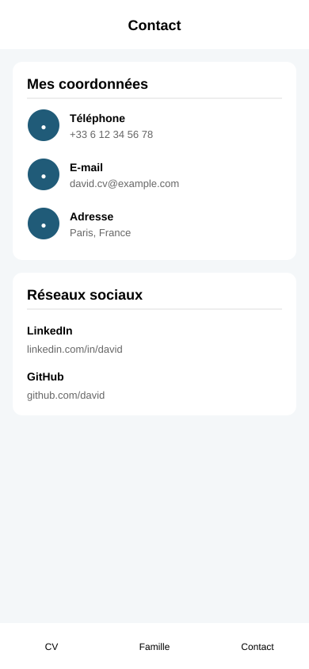

# CV Flutter — David

Application mobile Flutter présentant un CV personnel, les membres de la famille et les coordonnées de contact.

## Fonctionnalités

- Page de connexion avec identifiant et mot de passe masqué
- Validation du formulaire avant accès
- Page d'accueil contenant le profil, la formation, les expériences, les compétences, les langues et les centres d'intérêt
- Page famille présentant les membres sous forme de cartes/listes
- Page contact avec téléphone, e-mail, adresse et réseaux sociaux
- BottomNavigationBar et Drawer pour naviguer facilement
- Interfaces responsive (mobile et écran large)

## Captures d'écran

### 1. Connexion


### 2. Accueil / CV


### 3. Famille


### 4. Contact



## Lancement

```powershell
flutter pub get
flutter run
```

Sur la page de connexion, tout identifiant et mot de passe non vides permettent l'accès à l'application.

## Technologies

- Flutter
- Dart
- Material 3

## Personnalisation

Les informations sont centralisées dans les fichiers de `lib/` :

- `lib/cv_page.dart` : informations du CV
- `lib/family_page.dart` : membres de la famille
- `lib/contact_page.dart` : coordonnées
- `lib/login_page.dart` : formulaire de connexion
